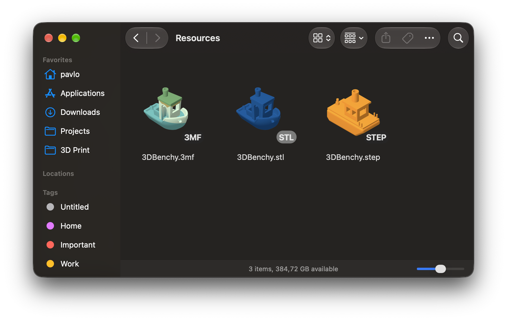

# STLer

Isometric (or orthographic) icons for `.stl`, `.3mf` and `.step` files in macOS Finder.

[](https://github.com/cagliostro1991/STLer/releases)
[](LICENSE)


**[Download the latest release](https://github.com/cagliostro1991/STLer/releases)** (macOS 13 or newer) or see [Install](#install).



macOS ships its own Quick Look provider for STL and does not let third-party
thumbnail extensions override it (tested: a `QLThumbnailProvider` for
`public.standard-tesselated-geometry-format` is never called, even with a custom
UTI). STLer renders each model offscreen with SceneKit and sets the result as the
file's custom icon via `NSWorkspace.setIcon`.

## Formats

STL, 3MF and STEP work today. What could come next, as a traffic light: 🟢 done or planned, 🟡 maybe, 🔴 unlikely because the format is closed or the licence is restrictive.

| Format | Light | Notes |
|---|---|---|
| STL, 3MF, STEP/STP | 🟢 Done | |
| OBJ, PLY | 🟢 Planned | read by macOS itself, same path as STL |
| IGES/IGS | 🟢 Planned | same engines as STEP, another reader |
| AMF | 🟡 Maybe | open XML like 3MF, needs its own loader, little used |
| F3D (Fusion) | 🟡 Maybe | only the embedded preview picture is readable, so the icon would not be ours |
| USDZ, ABC | 🟡 Maybe | readable by macOS, rarely needed for printing |
| glTF, GLB, DAE | 🟡 Maybe | open formats, but macOS cannot read them: a parser is needed |
| FBX | 🔴 Unlikely | Autodesk format, the official SDK has a restrictive licence |
| SLDPRT, IPT, CATPART | 🔴 Unlikely | closed CAD formats, unreadable without the vendors' software |

## Help, ideas, bugs

| You want to... | Go here |
|---|---|
| learn, fix a common problem | the [wiki](https://github.com/cagliostro1991/STLer/wiki): Getting started, FAQ, Troubleshooting |
| ask a question, share an idea | [Discussions](https://github.com/cagliostro1991/STLer/discussions) |
| report a bug | [bug report form](https://github.com/cagliostro1991/STLer/issues/new?template=bug_report.yml) |
| ask for a file format | [format request form](https://github.com/cagliostro1991/STLer/issues/new?template=format_request.yml) |
| report a security problem | [private report](https://github.com/cagliostro1991/STLer/security/advisories/new), see [SECURITY.md](SECURITY.md) |

In the app, General > About has "Report a problem", "Ask or suggest" and "Help and FAQ" with your versions already filled in. How to contribute: [CONTRIBUTING.md](CONTRIBUTING.md), [Code of Conduct](CODE_OF_CONDUCT.md).

## Install

Open the [Releases page](https://github.com/cagliostro1991/STLer/releases), download the latest `STLer-<version>-macos.zip` (betas are marked "Pre-release"), unpack it and move `STLer.app` to Applications. The build is ad-hoc signed and not notarized: the first time, right-click the app and choose Open, or run `xattr -dr com.apple.quarantine /Applications/STLer.app`. The window checks GitHub for newer releases at most once a day (switch it off in General); `stler update` does the same from the terminal. Release notes template and steps: `docs/release-template.md`.

## Build

```
make build   # build/stler and build/STLer.app
make test    # about 100 checks (around 20 seconds), no Xcode needed
```

Only the Command Line Tools are required; the app is ad-hoc signed. `swift build` is not supported (see `docs/adr/0004-swiftc-and-make-no-xcode.md`).

## Settings window

`STLer.app` looks like System Settings: a sidebar with General, STL, 3MF and STEP (each type's tile has the type's colour; a type that is off is gray and marked Off). Each file type page has its own switch, view (isometric, front, back, left, right, top, bottom), projection (orthographic or perspective), colour and format label (position, text colour, background colour, corner radius, opacity), plus Clear and Regenerate buttons. Changed settings apply on their own a second after your last change (a newer change cancels the older job and starts over), Regenerate draws every icon again, and Clear asks first. All of it runs as queued background jobs: the window never blocks, and the journal (icon at the bottom) shows finished, running and waiting jobs in one stream together with what `stler follow` did. On the first launch a welcome sheet explains what the app does and why the command line tool is needed (the question mark in the header shows it again). The header shows a green tick when `stler follow` runs as a LaunchAgent and an orange warning when it does not; clicking it explains what `follow` is for and leads to General, which has the status and an Install button that runs `stler install` in Terminal; it is checked at start, when the window gets focus and every 10 seconds. General holds the scope the buttons work on (any number of chosen folders, or your home folder with a confirmation that shows the file count) and how deep `follow` goes. Adding a folder starts rendering it at once. The preview on every page is a 3DBenchy variant rendered with that page's settings: the original STL, a 3MF with three plates (1, 2 and 3 boats, painted along different axes) and a STEP assembly of separate parts. "Choose sample..." swaps in any file of that type.

## CLI

```
stler [run] [--view V] [--projection orthographic|perspective] [--color system|#RRGGBB]
      [--label off|topLeft|topRight|bottomLeft|bottomRight] [--depth N|deep] [--force] [--dry-run] [<folder|file>...]
stler follow
stler install | uninstall
stler reset <folder|file>...
stler config get [key] | set <key> <value>
```

- `run` without paths uses the folder open in Finder (fallback: cwd). View flags change every enabled type for that run only.
- `follow` polls the front Finder window and renders each newly opened folder down to `followDepth`; a long run gives way when you open another folder.
- `install` copies the binary to `~/.local/bin/stler` and registers a LaunchAgent that keeps `follow` running at login; `uninstall` removes the agent.
- Files already rendered with the same settings are skipped (signature in the `dev.stler.sig` xattr, one per type). `reset` removes only icons that carry that signature, never icons you set yourself.

## Config

`~/.config/stler/config.json`, written by the settings window and by `stler config set`. Settings are per file type; older files with global `view`, `color`, `formats` and `badge` keys are migrated when read.

| key | values | default |
| --- | --- | --- |
| `<type>.enabled` | `stl`, `3mf`, `step` switch (`step` needs its engine) | stl, 3mf on; step off |
| `<type>.view` | `iso`, `front`, `back`, `left`, `right`, `top`, `bottom` | `iso` |
| `<type>.projection` | `orthographic`, `perspective` | `orthographic` |
| `<type>.color` | `system` (system gray) or `#RRGGBB` | per type: STL `#4f8ff7`, 3MF `#f59e42`, STEP `#a66cf0` |
| `<type>.label.corner` | `off` or the corner of the format label | `bottomRight` |
| `<type>.label.textColor` | `#RRGGBB` | `#ffffff` |
| `<type>.label.backgroundColor` | `#RRGGBB` | `#262626` |
| `<type>.label.cornerRadius` | 0 to 50, percent of the label height (50 = pill) | `50` |
| `<type>.label.opacity` | 0 to 1, background and text together | `0.85` |
| `<type>.modelColors` | `3mf`: 0 to 100, how much of the colours stored in the file replaces the fill colour (materials, Bambu/Orca filaments) | `0` |
| `<type>.limit` | `3mf`: how many plates of a multi-plate project to show; `step`: how many parts of an assembly (file order); `1`, `2`... or `all` | 3mf `1`, step `all` |
| `followDepth` | `1` (open folder only), `2`, `3`..., `0` = unlimited (`deep` in the CLI) | `3` |
| `stepEngine` | `freecad` or `opencascade`, only one is used | freecad |
| `freecadPath` | path to `freecadcmd`; empty = look in the usual places (`/Applications`, `~/Applications`, Homebrew) | empty |
| `followOpened` | `follow` gives a file its icon when it is opened anywhere (any folder or indexed drive), seen through a Spotlight live query | `false` |
| `followOpenedFolder` | with `followOpened`: also the other models in that file's own folder (no subfolders, at most 50) | `false` |
| `scope`, `scopeFolders` | where the window's icons are set and Clear works: `folder` with a list of folders (any number), or `home` | `folder`, empty list |

## Formats

- STL (via ModelIO)
- STEP/STP (optional): converted to a cached STL with FreeCAD's headless `freecadcmd`, one FreeCAD run per batch; the cache lives in `~/Library/Caches/stler`. Alternatively the OpenCASCADE library (`brew install opencascade`, 45 MB download, 160 MB on disk, instead of 2 GB) through a small helper that is compiled on first use. The STEP page switches between the two engines (never both). It is off by default and impossible to switch on while the chosen engine is missing: for FreeCAD the page searches for it (usual places, then Spotlight) or lets you choose it by hand, for OpenCASCADE it has an Install button that opens Terminal with the `brew install`.
- 3MF: core spec, `components` with transforms, production-extension `p:path`
  (Bambu Studio, Orca, Prusa, Fusion). Only the first plate of a Bambu/Orca
  project is rendered; `support` objects are skipped.

## Tests

`make test` compiles the core with `Tests/SelfCheck/main.swift` and runs the checks on temp files: config validation and migration, folder depth, 3MF transforms and first-plate filtering, per-type signatures, orientation, label and projection checked on rendered pixels, and an end-to-end render/skip/reset run that also asserts the file's modification date survives. `STLER_CONFIG=/some/file.json` keeps experiments away from your real config.

## Documentation

- `docs/architecture.md`: components and data flow
- `docs/adr/`: why things are the way they are
- `docs/knowledge/`: gotchas, safe testing, format notes, recipes
- `docs/roadmap.md`: what is left
- `AGENTS.md`: how to work on the repo, for people and coding assistants (`CLAUDE.md`, `GEMINI.md`, `.github/copilot-instructions.md` and `.cursor/rules` just point to it)
- `CONTRIBUTING.md`: PR basics

## Limitations

- The icon is stored in the file's resource fork: it is lost on `cp` without
  `-X`, in zip archives and on some network volumes.
- `follow` and the settings window read the front Finder window through
  AppleScript, so macOS asks once for Automation access to Finder.
- Z-up is assumed.
- F3D (Fusion archives) is not supported: the geometry is stored in undocumented binary blobs.
- Needs `/usr/bin/bsdtar` (ships with macOS) to read 3MF.
- The settings window and the LaunchAgent are not covered by automated tests.

## Credits

- App icon artwork (`icons/`) was generated with Gemini.
- 3DBenchy by Creative Tools ([public domain](https://www.3dbenchy.com/license/)) is the preview model in the README and the base of the samples in the settings window; the 3MF sample is the unmodified Benchy repeated and painted, the STEP sample is our own tugboat-style assembly (`Sources/STLerApp/Resources/3DBenchy.stl`, unmodified).
